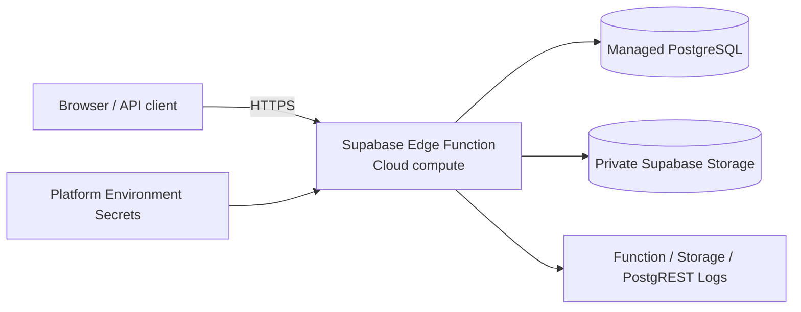

# Cloud Notes Platform

A live cloud-native application built for the Codomax Cloud Computing & DevOps internship Module 03.

**Production architecture:** Supabase Edge Function compute → managed PostgreSQL → private Supabase Storage → HTTPS networking → platform-provided server secrets → structured function/storage/database logs.

## Live deployment

- Application: https://ofkuwvuzlyigshwmdjhd.supabase.co/functions/v1/cloud-notes-platform
- Health: https://ofkuwvuzlyigshwmdjhd.supabase.co/functions/v1/cloud-notes-platform/health
- Status: https://ofkuwvuzlyigshwmdjhd.supabase.co/functions/v1/cloud-notes-platform/status

Verified deployment state:

- Edge Function: ACTIVE
- health endpoint: HTTP 200
- managed PostgreSQL: live
- Row Level Security: enabled
- direct anon/authenticated table access: explicitly denied
- private object-storage bucket: `codomax-files`
- bucket file limit: 1 MiB
- deployment proof object: `module3/deployment-proof.txt`
- Supabase security advisor: 0 findings
- performance advisor: 0 findings
- health advisor: 0 findings

## What this demonstrates

- serverless cloud compute;
- managed PostgreSQL;
- private object storage;
- public HTTPS networking;
- environment-scoped server secrets;
- explicit IAM/RLS boundary;
- structured application logging;
- health monitoring;
- bounded resource quotas;
- reproducible database and function configuration.

## Architecture



## Production endpoints

- `GET /` — application metadata
- `GET /health` — health probe
- `GET /demo-init` — idempotently creates one fixed database proof row and one fixed storage proof object
- `GET /status` — returns database/storage verification state and resource limits

The public demo initializer cannot create arbitrary user-controlled rows or filenames, preventing unbounded public writes.

## Security model

The `public.notes` table has RLS enabled and explicit deny policies for both `anon` and `authenticated` roles. The Edge Function is the server-side trust boundary and uses Supabase platform-provided secret credentials that never appear in client code or Git.

The `codomax-files` bucket is private and limited to 1 MiB objects. The demo endpoint writes only the fixed `module3/deployment-proof.txt` object.

## Resource controls

- note title: 120 characters;
- note body: 1,000 characters;
- storage object: 1 MiB maximum;
- public initializer: one fixed note + one fixed object;
- direct client DB access: denied.

## Verification

```bash
curl -fsS https://ofkuwvuzlyigshwmdjhd.supabase.co/functions/v1/cloud-notes-platform/health
curl -fsS https://ofkuwvuzlyigshwmdjhd.supabase.co/functions/v1/cloud-notes-platform/status
```

Expected health response:

```json
{"status":"ok","service":"cloud-notes-platform","module":3,"environment":"production"}
```

Expected status includes one note, a private bucket, and the storage proof object.

## Repository layout

- `supabase/schema.sql` — database, RLS, and private bucket configuration
- `supabase/functions/cloud-notes-platform/index.ts` — deployed Edge Function source
- `app/` — portable FastAPI implementation retained as an alternative runtime
- `docs/` — cloud-service and security/operations notes
- `render.yaml` — optional alternative hosting blueprint, not the production deployment used for the Codomax submission

## Cloud-service mapping

See `docs/cloud-services.md` and `docs/security-and-operations.md` for the internship objective mapping.
