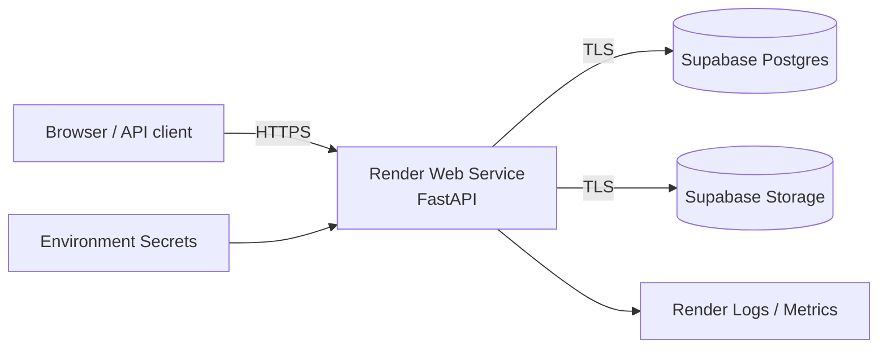

# Cloud Notes Platform

A small cloud-native web application built for the Codomax Cloud Computing & DevOps internship Module 03.

**Architecture:** FastAPI web service → Render compute → Supabase managed PostgreSQL + object storage → HTTPS networking, environment-scoped secrets, structured logs, health checks, and bounded request/upload sizes.

## What this demonstrates

- cloud compute through a managed web-service runtime;
- managed PostgreSQL;
- object storage;
- public HTTPS networking;
- environment variables and server-only secrets;
- least-privilege application boundary;
- application logging;
- health monitoring;
- explicit request/resource quotas;
- deployable cloud architecture.

## Architecture



## API

- `GET /` — application metadata
- `GET /health` — health probe
- `GET /api/notes` — list notes
- `POST /api/notes` — create a note
- `POST /api/files` — upload a bounded file to object storage

## Required environment variables

```text
SUPABASE_URL=
SUPABASE_SERVICE_ROLE_KEY=
SUPABASE_BUCKET=codomax-files
APP_ENV=production
MAX_UPLOAD_BYTES=1048576
MAX_NOTE_CHARS=1000
```

`SUPABASE_SERVICE_ROLE_KEY` is a server secret. Never expose it to browser code or commit it to Git.

## Supabase setup

Run `supabase/schema.sql` in the Supabase SQL editor, then create a private Storage bucket named `codomax-files`.

## Local run

```bash
python -m venv .venv
source .venv/bin/activate
pip install -r requirements.txt
cp .env.example .env
# fill real values locally; .env is gitignored
uvicorn app.main:app --reload
```

## Render deployment

This repository includes `render.yaml`. Create a Render Web Service from the repository and set the Supabase environment variables in the Render dashboard. The service uses `/health` as its health-check endpoint.

## Security notes

- secrets live only in environment configuration;
- `.env` is ignored by Git;
- file uploads are capped by `MAX_UPLOAD_BYTES`;
- note text is capped by `MAX_NOTE_CHARS`;
- storage objects are written by the server only;
- database/storage credentials are never returned by the API;
- structured application logs avoid printing secrets;
- the cloud service is reached only over HTTPS in normal hosted operation.

## Verification

After deployment:

```bash
curl -fsS https://YOUR-SERVICE.onrender.com/health
curl -fsS https://YOUR-SERVICE.onrender.com/api/notes
```

Create a note:

```bash
curl -fsS -X POST https://YOUR-SERVICE.onrender.com/api/notes \
  -H 'Content-Type: application/json' \
  -d '{"title":"Cloud deployment","body":"Module 03 is live."}'
```

## Cloud-service mapping

See `docs/cloud-services.md` and `docs/security-and-operations.md` for the internship objective mapping.
